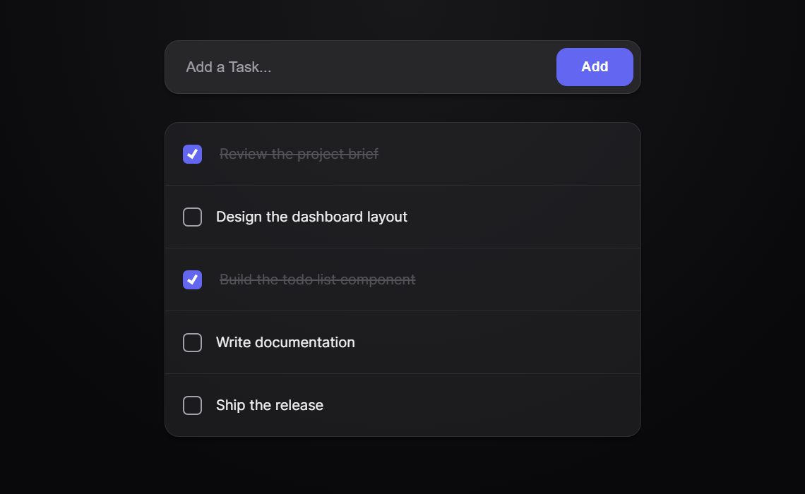

# Todo App

A clean, responsive task manager built with vanilla HTML, CSS, and JavaScript. No frameworks, no dependencies, no build step — just a polished interface for keeping track of what needs to get done.




## Overview

Todo App is a lightweight, browser-based task list. Add tasks, mark them complete, and remove the ones you no longer need. The interface uses a dark, glassmorphic design with subtle motion, and adapts cleanly from desktop to mobile.

The project is intentionally dependency-free, making it a straightforward reference for working with the DOM, event handling, and modern CSS.

## Features

- **Add tasks** — submit with the **Add** button or press <kbd>Enter</kbd>; blank or whitespace-only tasks are ignored.
- **Mark as complete** — a custom animated checkbox strikes through and fades the task.
- **Delete tasks** — remove individual items (button appears on hover on desktop, always visible on touch devices).
- **Empty state** — a friendly message is displayed automatically when the list is empty.
- **Responsive layout** — the input and button stack on small screens for comfortable tapping.
- **Polished dark UI** — indigo accent color, gradients, glass blur, entrance animations, and clear hover/focus states.
- **Zero dependencies** — plain HTML, CSS, and JavaScript with no installation required.

> **Note:** Tasks live in memory only. Refreshing the page clears the list — persistence is on the roadmap.

## Tech Stack

| Layer | Technology |
| --- | --- |
| Markup | HTML5 |
| Styling | CSS3 — custom properties, Flexbox, animations, media queries |
| Behavior | Vanilla JavaScript (ES6+) — DOM API and event listeners |
| Tooling | None — no frameworks, package manager, or build step |

## Getting Started

### Prerequisites

A modern web browser is all you need. [Git](https://git-scm.com/) is required only if you want to clone the repository.

### Run locally

```bash
git clone https://github.com/Kryptonae/Todo-App.git
cd Todo-App
```

Then open `index.html` in your browser.

For a local development server (recommended if you plan to make changes), you can use any static server. For example:

```bash
npx serve .
```

Or, in VS Code, install the [Live Server](https://marketplace.visualstudio.com/items?itemName=ritwickdey.LiveServer) extension and click **Go Live**.

## Usage

1. Type a task into the input field.
2. Press <kbd>Enter</kbd> or click **Add**.
3. Check the box next to a task to mark it complete.
4. Hover over a task and click **Delete** to remove it.

## Project Structure

```text
Todo-App/
├── assets/
│   └── preview.png    # README preview image
├── index.html         # App markup
├── script.js          # Task creation, completion, and deletion logic
├── style.css          # Theme, layout, and animations
└── README.md
```

## How It Works

- `script.js` listens for the form's `submit` event and calls `handleAddTodo`, which trims and validates the input.
- Each task is rendered as a list item containing a checkbox, a text span, and a delete button.
- Checking a task toggles the `checkBox` class, which applies the completed styling in CSS.
- Delete buttons remove their own list item from the DOM.
- The empty state is pure CSS, rendered through the `#todoList:empty::after` pseudo-element.

## Customization

The theme is controlled by CSS custom properties at the top of `style.css`. Change these values to restyle the entire app:

| Variable | Purpose | Default |
| --- | --- | --- |
| `--bg-primary` | Page background | `#09090b` |
| `--surface` | Cards, inputs, and form container | `#27272a` |
| `--text-primary` | Primary text | `#f4f4f5` |
| `--text-secondary` | Muted text and placeholders | `#a1a1aa` |
| `--accent` | Primary action and checked state | `#6366f1` |
| `--danger` | Delete action | `#ef4444` |

## Roadmap

- [ ] Persist tasks with `localStorage`
- [ ] Inline editing for existing tasks
- [ ] Filters for all, active, and completed tasks with counts
- [ ] Due dates and priority levels
- [ ] Drag-and-drop reordering
- [ ] Light/dark theme toggle
- [ ] Automated tests

## Contributing

Contributions, bug reports, and feature suggestions are welcome.

1. Fork the repository.
2. Create a feature branch: `git checkout -b feature/your-feature`.
3. Commit your changes: `git commit -m "Add your feature"`.
4. Push the branch: `git push origin feature/your-feature`.
5. Open a pull request.

For larger changes, please open an issue first so the approach can be discussed.

## Author

**Ashwani Kumar** ([@Kryptonae](https://github.com/Kryptonae))

## License

No license has been added to this project yet. Until one is included, all rights are reserved by the author. If you would like to reuse this code, please reach out first.
